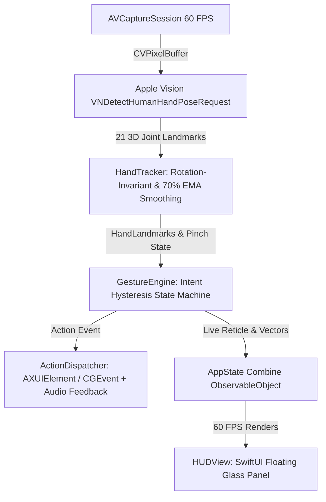

# GestureFlow — Comprehensive Project & Architecture Handoff

> **Target Platform**: macOS 14.0+ (Sonoma, Sequoia)  
> **Hardware Target**: Apple Silicon (M1/M2/M3/M4) with Apple Neural Engine (ANE)  
> **Language & Frameworks**: Swift 5.9+, SwiftUI, Apple Vision (`Vision.framework`), AVFoundation, CoreGraphics, Accessibility (`AXUIElement`)  
> **App Location**: `/Applications/GestureFlow.app`  
> **Source Directory**: `GestureFlowApp/`

---

## 1. Executive Summary

**GestureFlow** is a native, lightweight, ultra-low latency (60 FPS locked, <1% CPU) hand-gesture shortcut controller for macOS. It is designed specifically for **fluid system multitasking** without touching the mouse or keyboard:
- **Pinch & Drag navigation** (Vision Pro inspired) for switching apps and controlling window states.
- **Open-Hand Swiping** for switching macOS Desktop Spaces.
- **Floating Glassmorphism HUD** overlaying neon skeletal tracking, live pinch reticles, and trigger toasts.

---

## 2. Gesture Mapping Specification

| Interaction Mode | Physical Gesture | System Shortcut / API | Action Triggered |
| :--- | :--- | :--- | :--- |
| **Pinch Horizontal** | 🤏 Chụm Ngón Cái + Trỏ rồi kéo sang **Phải** | `⌘ + Tab` | Chuyển sang Ứng dụng kế tiếp (**Next App**) |
| **Pinch Horizontal** | 🤏 Chụm Ngón Cái + Trỏ rồi kéo sang **Trái** | `⌘ + ⇧ + Tab` | Chuyển về Ứng dụng trước đó (**Prev App**) |
| **Pinch Vertical** | 🤏 Chụm Ngón Cái + Trỏ rồi kéo lên **Trên** | `AXFullScreen` / `⌃ + ⌘ + F` | Phóng to toàn màn hình (**Maximize / Fullscreen**) |
| **Pinch Vertical** | 🤏 Chụm Ngón Cái + Trỏ rồi kéo xuống **Dưới** | `AXMinimized` / `⌘ + M` | Thu nhỏ cửa sổ hiện tại (**Minimize Window**) |
| **Full Hand Swipe** | 🖐 Xòe 4–5 ngón tay vẩy dứt khoát sang **Phải** | `⌃ + →` (Key 124) | Chuyển sang Desktop Space bên **Phải** |
| **Full Hand Swipe** | 🖐 Xòe 4–5 ngón tay vẩy dứt khoát sang **Trái** | `⌃ + ←` (Key 123) | Chuyển sang Desktop Space bên **Trái** |
| **Full Hand Swipe** | 🖐 Xòe 4–5 ngón tay vẩy dứt khoát lên **Trên** | `⌃ + ↑` (Key 126) | Mở tổng quan các cửa sổ (**Mission Control**) |
| **Full Hand Swipe** | 🖐 Xòe 4–5 ngón tay vẩy dứt khoát xuống **Dưới** | `⌃ + ↓` (Key 125) | Hiện cửa sổ ứng dụng hiện tại (**App Exposé**) |

---

## 3. Architecture & Data Flow Pipeline



---

## 4. Source Files Deep-Dive

### 📂 `GestureFlowApp/Sources/GestureFlow/`

#### 1. `Camera/CameraManager.swift`
- Replaces Python/OpenCV camera capture with native `AVCaptureSession` and `AVCaptureVideoDataOutput`.
- Dispatches hardware-accelerated frames on a dedicated high-priority queue (`qos: .userInteractive`).
- Configures 640x480 resolution for optimal ANE throughput at locked 60 FPS with zero dropped frames.

#### 2. `Tracking/HandTracker.swift`
- Executes Apple Vision's `VNDetectHumanHandPoseRequest` on Apple Neural Engine.
- **Rotation-Invariant Finger Extension**: Evaluates fingertip-to-wrist distance versus MCP/PIP knuckle distances ($\text{dist}(\text{Tip}, \text{Wrist}) > 1.05 \times \text{dist}(\text{PIP}, \text{Wrist})$) to detect finger state regardless of hand rotation.
- **Pinch Center & Distance**: Measures Euclidean distance between thumb tip and index tip. Computes screen-mirrored center point.
- **Low-Pass Filter (EMA Smoothing)**: Applies $\alpha = 0.70$ temporal filter across all 21 landmark nodes to eliminate webcam sensor micro-jitter.

#### 3. `Tracking/GestureEngine.swift`
- **Pinch & Drag State Machine**:
  - Activates when $\text{pinchDistance} < 0.065$.
  - Requires intentional displacement ($\Delta \ge 0.070$ frame width) before dispatching an action.
  - Directional disambiguation: Compares $|dx|$ vs $|dy|$ with a $1.1\times$ dominant axis check.
  - **Single-Fire Lock**: Dispatches exactly once per pinch gesture; prevents repeated spamming.
- **Open-Hand Desktop Space Swipe**:
  - Requires $\text{fingerCount} \ge 4$ and unpinched hand.
  - Sliding velocity buffer ($0.04\text{s} \le \Delta t \le 0.28\text{s}$, displacement $\ge 0.10$, cooldown $450\text{ms}$).

#### 4. `Tracking/ActionDispatcher.swift`
- **Hybrid Dispatch Architecture**:
  - **Direct Accessibility API (`AXUIElement`)**: Directly toggles `kAXMinimizedAttribute` and `AXFullScreen` on the frontmost application's focused window without keyboard buffer latency.
  - **Native `CGEvent` CoreGraphics**: Posts keystrokes with modifiers to `.cghidEventTap` via `.combinedSessionState`.
- **Audio Feedback**: Invokes `NSSound(named: "Tink")?.play()` on successful dispatch for instant tactile/auditory confirmation.

#### 5. `UI/HUDView.swift`
- Modern macOS Glassmorphism design using `.ultraThinMaterial`, dynamic stroke gradients, and drop shadows.
- **Neon Skeleton View**: Renders hand bone connectivity lines and glowing fingertip nodes (gold for pinch tips, cyan for other fingertips).
- **Pinch Reticle View**: Renders a pulsing circular target at the active pinch coordinates with a dynamic directional arrow showing drag intent.
- **Dynamic Trigger Toast**: Displays gold glowing pill animations (`bolt.fill`) upon gesture execution.

#### 6. `main.swift`
- Configures a borderless, non-activating floating `NSPanel` (`.floating`, `.canJoinAllSpaces`, `.fullScreenAuxiliary`).
- Runs periodic background checks on `AXIsProcessTrusted()` to toggle the accessibility warning banner seamlessly.

---

## 5. Security, Codesigning & macOS TCC Secrets

### The Problem:
On macOS Sonoma/Sequoia, ad-hoc signed apps (`codesign -s -`) produce a new cryptographic `CDHash` every time the binary is recompiled. macOS TCC (Transparency, Consent, and Control) identifies ad-hoc apps by `CDHash` rather than bundle ID. This causes macOS to silently block Accessibility permissions on rebuilt binaries even if the toggle shows **ON** in System Settings.

### The Solution:
1. A permanent local code-signing certificate named **`GestureFlow Developer`** is installed in `~/Library/Keychains/login.keychain-db`.
2. The `Makefile` signs the bundle with:
   ```bash
   codesign --force --deep --sign "GestureFlow Developer" --identifier com.user.GestureFlow GestureFlow.app
   ```
3. Because the identity is anchored to a trusted certificate subject, macOS TCC permissions persist across builds.

---

## 6. Build, Install & Management Commands

```bash
# Navigate to project root
cd /Users/thundercock2/Documents/antigravity/focused-davinci/GestureFlowApp

# Build release binary, package app, and sign with persistent certificate
make build

# Install to /Applications/GestureFlow.app
make install

# Launch / Relaunch app
make run

# Stop app
make stop

# Clean build artifacts
make clean
```

---

## 7. Extension & Future Feature Vectors

For incoming engineers or LLMs working on this codebase:
1. **Window Snap & Tile (Aerospace / Rectangle integration)**:
   - Add Pinch + Corner Drags (Top-Left, Top-Right) for 50% split screen tiling via `AXUIElementSetAttributeValue(window, kAXPositionAttribute, ...)`.
2. **Multi-Hand Coordination**:
   - `HandTracker.swift` currently sets `maximumHandCount = 1`. Can be expanded to 2 hands for two-handed zoom/rotate or dual-window orchestration.
3. **Menu Bar Extra / Tray Toggle**:
   - Convert `LSUIElement` to `true` in `Info.plist` and add `NSStatusItem` for background menu bar mode.
