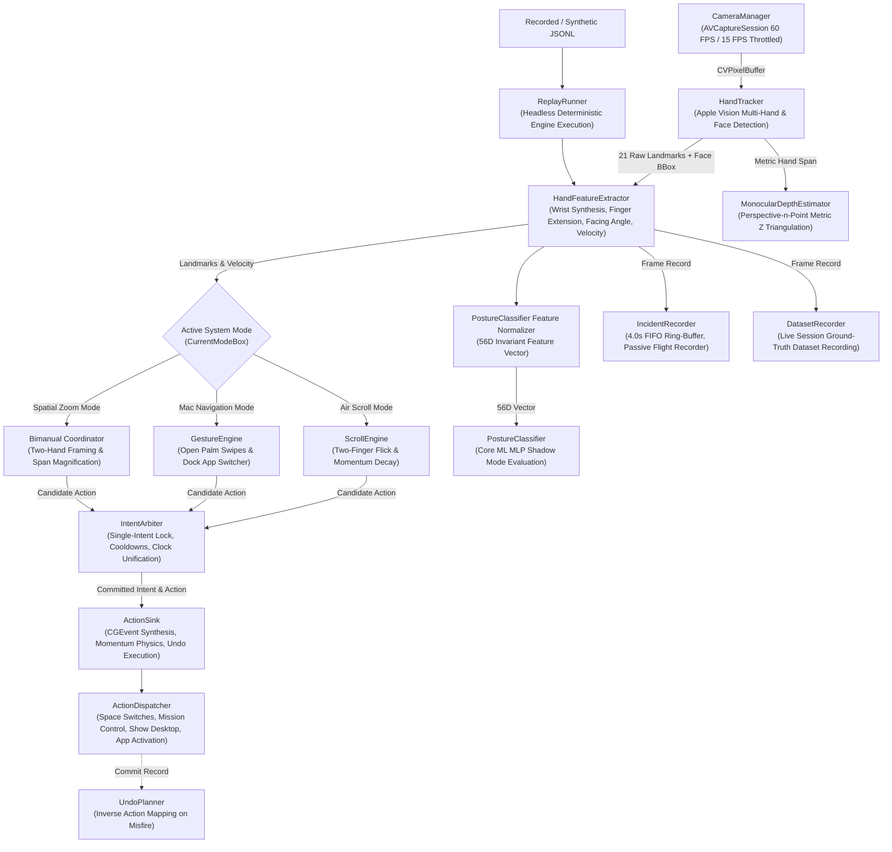

# GestureFlow — System Architecture & Component Reference

## 1. Pipeline Architecture

The following diagram illustrates the complete end-to-end data processing pipeline of GestureFlow, including real-time video capture, computer vision landmark extraction, kinematic evaluation, mutual exclusion arbitration, and operating system event synthesis, alongside offline replay, training, and flight-recorder subsystems.

---

## 2. Concurrency & Threading Model

GestureFlow coordinates work across distinct queues to ensure zero frame drops on the camera stream and zero UI hitching on the main thread:

1. **`com.gestureflow.camera` (QoS `.userInteractive`)**:
   - AVCapture video buffer processing.
   - Apple Vision neural hand pose and face detection.
   - Kinematic feature computation and engine state transitions (`GestureEngine`, `ScrollEngine`).
   - Incident ring-buffer ingestion and dataset frame writing.
   - **Cross-Thread Synchronization**: System mode is read via lock-protected `CurrentModeBox` (`AppState.currentModeBox.mode`) to prevent data races with UI mode shortcuts.
2. **Main Thread (`DispatchQueue.main`)**:
   - SwiftUI View rendering (`HUDView`, `ApplicationSwitcherView`, `HolographicSkeletonView`).
   - AppKit NSStatusItem and NSMenu interactions (`MenuBar.swift`).
   - Mode switching (`Cmd+1`, `Cmd+2`, `Cmd+3`) updating `AppState.currentMode`.
3. **`com.gestureflow.incidents` (QoS `.utility`)**:
   - Asynchronous disk serialization of 4.0s landmark snapshots upon incident trigger (`⌃⌥⌘M` / `⌃⌥⌘N` / auto-fire).
4. **`com.gestureflow.recorder` (QoS `.utility`)**:
   - Asynchronous append-only disk serialization for live dataset recordings.

For a detailed function-by-function and callback-by-callback audit table with exact line citations, see [THREADING.md](file:///Users/thundercock2/Documents/Github/Project-G1/docs/gesture/THREADING.md).

---

## 3. Complete Source Module Directory

Every file in the codebase is listed below with its primary technical responsibility:

### Swift Application & Tracking Core (`GestureFlowApp/Sources/GestureFlow/`)

#### App Lifecycle & Orchestration
- [AppDelegate.swift](file:///Users/thundercock2/Documents/Github/Project-G1/GestureFlowApp/Sources/GestureFlow/App/AppDelegate.swift): AppKit application delegate managing window hierarchy, status items, and global pipeline lifecycle.
- [AppState.swift](file:///Users/thundercock2/Documents/Github/Project-G1/GestureFlowApp/Sources/GestureFlow/App/AppState.swift): Central observable application state with thread-safe `CurrentModeBox` and persistent user defaults.
- [GateVerification.swift](file:///Users/thundercock2/Documents/Github/Project-G1/GestureFlowApp/Sources/GestureFlow/App/GateVerification.swift): Headless automated verification suite for intentionality gating mechanisms (`--test-gates`).
- [KeyboardMonitors.swift](file:///Users/thundercock2/Documents/Github/Project-G1/GestureFlowApp/Sources/GestureFlow/App/KeyboardMonitors.swift): Global and local event monitors for incident tagging hotkeys (`⌃⌥⌘M`/`⌃⌥⌘N`) and dataset labeling keys (`0`–`8`).
- [MenuBar.swift](file:///Users/thundercock2/Documents/Github/Project-G1/GestureFlowApp/Sources/GestureFlow/App/MenuBar.swift): Status bar menu item, system mode selectors, sensitivity preset switches, calibration triggers, and settings.
- [Pipeline.swift](file:///Users/thundercock2/Documents/Github/Project-G1/GestureFlowApp/Sources/GestureFlow/App/Pipeline.swift): Frame subscriber wiring camera output to active mode engines with thread-safe mode dispatch.
- [main.swift](file:///Users/thundercock2/Documents/Github/Project-G1/GestureFlowApp/Sources/GestureFlow/main.swift): Application entry point handling CLI arguments (`--replay`, `--guided`, `--test-gates`, `--tune`) or launching NSApplication.

#### Camera Subsystem
- [CameraManager.swift](file:///Users/thundercock2/Documents/Github/Project-G1/GestureFlowApp/Sources/GestureFlow/Camera/CameraManager.swift): AVFoundation video capture session with dynamic 60 FPS active / 15 FPS idle power-saving throttle.

#### Tracking & Kinematic Engines
- [ActionDispatcher.swift](file:///Users/thundercock2/Documents/Github/Project-G1/GestureFlowApp/Sources/GestureFlow/Tracking/ActionDispatcher.swift): System event synthesizer handling Space switching, Mission Control, Show Desktop, and Dock app activation.
- [ActionSink.swift](file:///Users/thundercock2/Documents/Github/Project-G1/GestureFlowApp/Sources/GestureFlow/Tracking/ActionSink.swift): Abstract action sink routing synthetic CGEvent scrolls, DisplayLink momentum physics ticks, and undo actions.
- [CalibrationMath.swift](file:///Users/thundercock2/Documents/Github/Project-G1/GestureFlowApp/Sources/GestureFlow/Tracking/CalibrationMath.swift): Statistical mathematics engine (median, windowed peak displacement/velocity, threshold clamp derivation).
- [CalibrationReplayRunner.swift](file:///Users/thundercock2/Documents/Github/Project-G1/GestureFlowApp/Sources/GestureFlow/Tracking/CalibrationReplayRunner.swift): Headless evaluation runner for calibration session logs.
- [CalibrationWizard.swift](file:///Users/thundercock2/Documents/Github/Project-G1/GestureFlowApp/Sources/GestureFlow/Tracking/CalibrationWizard.swift): 60-second interactive guided wizard adapting sensitivity thresholds to natural user kinematics.
- [Clock.swift](file:///Users/thundercock2/Documents/Github/Project-G1/GestureFlowApp/Sources/GestureFlow/Tracking/Clock.swift): Monotonic clock protocol and implementations (`SystemClock`, `MockClock`) guaranteeing deterministic time arbitration.
- [DatasetRecorder.swift](file:///Users/thundercock2/Documents/Github/Project-G1/GestureFlowApp/Sources/GestureFlow/Tracking/DatasetRecorder.swift): JSONL streaming recorder persisting raw landmarks and ground-truth labels during training collection.
- [DepthRecorder.swift](file:///Users/thundercock2/Documents/Github/Project-G1/GestureFlowApp/Sources/GestureFlow/Tracking/DepthRecorder.swift): Depth verification utility benchmarking monocular PnP depth against sensor ground truth.
- [FeatureDumper.swift](file:///Users/thundercock2/Documents/Github/Project-G1/GestureFlowApp/Sources/GestureFlow/Tracking/FeatureDumper.swift): Headless extractor exporting 56D invariant posture features from recorded JSONL datasets.
- [GestureEngine.swift](file:///Users/thundercock2/Documents/Github/Project-G1/GestureFlowApp/Sources/GestureFlow/Tracking/GestureEngine.swift): Kinematic state machine evaluating open-palm horizontal/vertical swipes and dock application scrubbing.
- [GestureTuning.swift](file:///Users/thundercock2/Documents/Github/Project-G1/GestureFlowApp/Sources/GestureFlow/Tracking/GestureTuning.swift): Decoupled threshold configuration with safe/balanced/sensitive presets, custom lerping, and backwards-compatible JSON decoding.
- [GuidedSession.swift](file:///Users/thundercock2/Documents/Github/Project-G1/GestureFlowApp/Sources/GestureFlow/Tracking/GuidedSession.swift): 7-minute voice-prompted audio session guiding users through standardized gesture collection protocols.
- [HandFeatureExtractor.swift](file:///Users/thundercock2/Documents/Github/Project-G1/GestureFlowApp/Sources/GestureFlow/Tracking/HandFeatureExtractor.swift): Kinematic geometry calculator extracting finger extensions, palm centroids, facing normals, and velocities.
- [HandTracker.swift](file:///Users/thundercock2/Documents/Github/Project-G1/GestureFlowApp/Sources/GestureFlow/Tracking/HandTracker.swift): Apple Vision framework coordinator tracking up to 2 hands, synthesizing keyboard-clipped wrists, and detecting face boxes.
- [IncidentRecorder.swift](file:///Users/thundercock2/Documents/Github/Project-G1/GestureFlowApp/Sources/GestureFlow/Tracking/IncidentRecorder.swift): 4.0-second FIFO ring-buffer capturing misfires (`⌃⌥⌘M`), missed gestures (`⌃⌥⌘N`), and auto-fires without storing pixels.
- [IntentArbiter.swift](file:///Users/thundercock2/Documents/Github/Project-G1/GestureFlowApp/Sources/GestureFlow/Tracking/IntentArbiter.swift): Mutual-exclusion temporal arbiter enforcing intent ownership, lockouts, and unified reference-date cooldowns.
- [MonocularDepthEstimator.swift](file:///Users/thundercock2/Documents/Github/Project-G1/GestureFlowApp/Sources/GestureFlow/Tracking/MonocularDepthEstimator.swift): Perspective-n-Point metric depth estimator translating normalized hand spans into physical metric distance ($Z$).
- [OneEuroFilter.swift](file:///Users/thundercock2/Documents/Github/Project-G1/GestureFlowApp/Sources/GestureFlow/Tracking/OneEuroFilter.swift): Adaptive 1€ filter smoothing high-frequency jitter during stationary pauses while preserving responsive snap on fast motions.
- [PostureClassifier.swift](file:///Users/thundercock2/Documents/Github/Project-G1/GestureFlowApp/Sources/GestureFlow/Tracking/PostureClassifier.swift): Core ML runtime evaluator running static posture inference in shadow mode.
- [RejectReason.swift](file:///Users/thundercock2/Documents/Github/Project-G1/GestureFlowApp/Sources/GestureFlow/Tracking/RejectReason.swift): Categorical taxonomy of gesture rejection causes displayed on HUD diagnostic badges.
- [ReplayRunner.swift](file:///Users/thundercock2/Documents/Github/Project-G1/GestureFlowApp/Sources/GestureFlow/Tracking/ReplayRunner.swift): Headless deterministic replay harness executing recorded streams through engines with mock clocks.
- [ScrollEngine.swift](file:///Users/thundercock2/Documents/Github/Project-G1/GestureFlowApp/Sources/GestureFlow/Tracking/ScrollEngine.swift): Air Scroll engine tracking two-finger flicks, exponential momentum decay, and open-palm brake gestures.
- [TelemetryLogger.swift](file:///Users/thundercock2/Documents/Github/Project-G1/GestureFlowApp/Sources/GestureFlow/Tracking/TelemetryLogger.swift): Async low-priority JSONL logger recording gesture activations in Application Support.
- [UndoPlanner.swift](file:///Users/thundercock2/Documents/Github/Project-G1/GestureFlowApp/Sources/GestureFlow/Tracking/UndoPlanner.swift): Inverse action planner mapping forward gesture actions to their deterministic reversals on misfire marks.

#### User Interface
- [ApplicationSwitcherView.swift](file:///Users/thundercock2/Documents/Github/Project-G1/GestureFlowApp/Sources/GestureFlow/UI/ApplicationSwitcherView.swift): Full-screen spatial overlay rendering elastic catenary pearl tether and viewfinder reticle.
- [HUDView.swift](file:///Users/thundercock2/Documents/Github/Project-G1/GestureFlowApp/Sources/GestureFlow/UI/HUDView.swift): Frosted obsidian glass floating HUD supporting compact mini-pill and expanded camera viewport.
- [HolographicSkeletonView.swift](file:///Users/thundercock2/Documents/Github/Project-G1/GestureFlowApp/Sources/GestureFlow/UI/HolographicSkeletonView.swift): 2D/3D vector canvas rendering 21-point hand skeleton landmarks with dynamic depth styling.

### Swift Unit Tests (`GestureFlowApp/Tests/GestureFlowTests/`)
- [CalibrationMathTests.swift](file:///Users/thundercock2/Documents/Github/Project-G1/GestureFlowApp/Tests/GestureFlowTests/CalibrationMathTests.swift): Tests statistical median calculations, synthetic velocity/displacement extraction, and clamp derivation.
- [GestureTuningTests.swift](file:///Users/thundercock2/Documents/Github/Project-G1/GestureFlowApp/Tests/GestureFlowTests/GestureTuningTests.swift): Tests legacy JSON decoding without `useLearnedPosture`, baseline equivalence, and lerp endpoints.
- [SmokeTests.swift](file:///Users/thundercock2/Documents/Github/Project-G1/GestureFlowApp/Tests/GestureFlowTests/SmokeTests.swift): Baseline test verifying default tuning parameters.
- [UndoPlannerTests.swift](file:///Users/thundercock2/Documents/Github/Project-G1/GestureFlowApp/Tests/GestureFlowTests/UndoPlannerTests.swift): Tests inverse action mapping table, arbiter commit window lookups, and ActionSink dispatch.

### Evaluation, Benchmarking & Tooling Suite (`tools/`)
- [tools/eval_gestures.py](file:///Users/thundercock2/Documents/Github/Project-G1/tools/eval_gestures.py): Event-level recall scorer, direction confusion matrix, incident analyzer with Wilson CIs, and shadow classifier evaluator.
- [tools/export_features.py](file:///Users/thundercock2/Documents/Github/Project-G1/tools/export_features.py): Feature normalization script extracting translation, scale, rotation, and handedness invariant 56D posture vectors.
- [tools/train_posture.py](file:///Users/thundercock2/Documents/Github/Project-G1/tools/train_posture.py): Model trainer exporting Core ML MLP posture classifiers with diversity gating ($\ge 3$ distinct sessions).
- [tools/sweep.py](file:///Users/thundercock2/Documents/Github/Project-G1/tools/sweep.py): Sensitivity parameter grid-search replaying candidate vectors headlessly (guarded against $< 20$ gesture windows).
- [tools/make_synthetic_fixtures.py](file:///Users/thundercock2/Documents/Github/Project-G1/tools/make_synthetic_fixtures.py): Deterministic generator producing the 13 synthetic scenario fixtures.
- [tools/perturb.py](file:///Users/thundercock2/Documents/Github/Project-G1/tools/perturb.py): Deterministic geometric transforms (jitter, frame drops, downsampling, timestamp jitter, horizontal mirroring).
- [tools/robustness_synthetic.py](file:///Users/thundercock2/Documents/Github/Project-G1/tools/robustness_synthetic.py): Systematic robustness evaluator testing 56 conditions $\times$ 10 seeds (560 evaluations).
- [tools/bench_replay.py](file:///Users/thundercock2/Documents/Github/Project-G1/tools/bench_replay.py): Headless throughput and latency benchmark measuring engine performance over 60,000 continuous frames.
- [tools/report.py](file:///Users/thundercock2/Documents/Github/Project-G1/tools/report.py): One-command evaluation report generator producing Markdown reports across recordings and flight-recorder incident logs.
- [tools/test_replay.py](file:///Users/thundercock2/Documents/Github/Project-G1/tools/test_replay.py): Regression test asserting exact fired actions and byte-identical determinism across all fixtures.
- [tools/test_eval_gestures.py](file:///Users/thundercock2/Documents/Github/Project-G1/tools/test_eval_gestures.py): Unit tests for event scoring, direction matching, Wilson confidence intervals, and incident loading.
- [tools/test_export_features.py](file:///Users/thundercock2/Documents/Github/Project-G1/tools/test_export_features.py): Unit tests for 56D feature normalization invariances (translation, scale, rotation, mirroring).
- [tools/test_feature_parity.py](file:///Users/thundercock2/Documents/Github/Project-G1/tools/test_feature_parity.py): Floating-point parity assertion verifying that Swift and Python 56D feature vectors match within $10^{-4}$.
- [tools/test_robustness_synthetic.py](file:///Users/thundercock2/Documents/Github/Project-G1/tools/test_robustness_synthetic.py): Unit test for synthetic perturbation harness in fast CI mode.
- [tools/test_report.py](file:///Users/thundercock2/Documents/Github/Project-G1/tools/test_report.py): Unit and integration tests for the one-command report generator.
