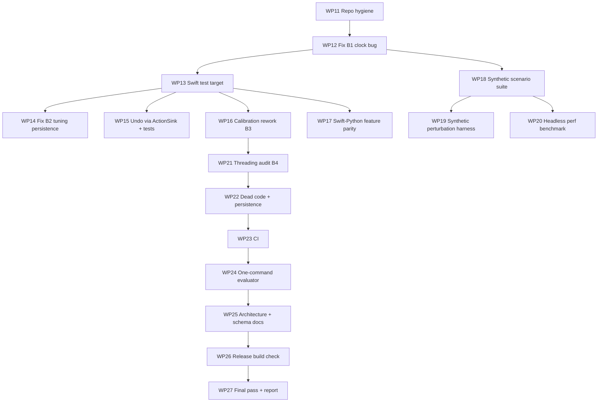

# GestureFlow — Executor Plan V2 (hands-free work only)

> **Audience**: an autonomous coding model executing this file top to bottom.
> **User constraint**: the user **cannot physically test** right now. No step in this plan may require a camera, a hand, a microphone, a system permission prompt, or launching the GUI app.
> **Start command for the user**: *"Execute `docs/gesture/EXECUTOR_PLAN_V2.md` from WP11, following its rules."*

---

## 0. Rules (read twice; they override everything below)

| # | Rule |
| :-- | :-- |
| **R1 No hands** | Never launch the GUI app (`GestureFlow` with no flags, `--guided`, `--record`). The only allowed binary invocations are headless CLI modes: `--replay`, and new headless flags added by this plan. If a step seems to need live testing, mark it `NEEDS-USER` in PROGRESS.md and move on. |
| **R2 No invented numbers** | Every number written into any doc, commit message or report must be copied from command output **produced in the same session**, with the exact command next to it. If you did not run it, write `not measured`. Numbers from synthetic fixtures must be labelled **"synthetic — code-path check, not recognition accuracy"**. |
| **R3 Verify before documenting** | Before you write a CLI flag, file path, function name or default value into a doc, confirm it with `grep` (`grep -n "add_argument(" tools/*.py`, `grep -n 'firstIndex(of: "--' -r GestureFlowApp/Sources`). Every shell command you put in a doc must be smoke-run once (on fixtures) before committing. A previous executor shipped docs with wrong flags (`--output` instead of `--out`, a nonexistent `--file`, `--out-dir`) and cited recordings that did not exist. Do not repeat this. |
| **R4 Goldens are sacred** | `tools/golden/*.golden.jsonl` must stay **byte-identical** unless the WP explicitly says "behaviour change; regenerate goldens". If `python3 -m unittest tools/test_replay.py` starts failing after your change, **revert your change** (not the golden) and rethink. Never edit a golden or an expected-action table to make a test pass. |
| **R5 Sandbox** | `swift build`, `swift test`, and every `git add/commit/push/remote` command must run with `BypassSandbox: true` (the sandbox cannot write `.git/` or the Swift module cache). Python tests and `grep`/`cat` run fine sandboxed. Keep `toolAction`/`toolSummary` identical on a retry. |
| **R6 Build times** | Touching `App/AppState.swift`, `UI/HUDView.swift`, or `UI/ApplicationSwitcherView.swift` triggers ~5–6 min SwiftUI rebuilds; logic-only files rebuild in ~30–60 s. Start builds with `WaitMsBeforeAsync: 10000`, then **stop calling tools** and wait for the completion notification. Never poll. |
| **R7 Zero warnings** | A build counts as clean only if `grep -c "warning:"` on its output, ignoring the two `org.swift.swiftpm ... not accessible` cache lines, is 0. |
| **R8 Git** | The user wants **one branch: `main`**. Commit directly to `main`, one commit per WP step, and push after each WP (`git push origin main`). Forbidden: `push --force`, `reset --hard`, `clean -fd`, `rebase`, branch deletion, amending pushed commits. |
| **R9 Defaults frozen** | Do not change `GestureTuning.balanced` values, `useLearnedPosture = false`, `undoOnMisfire = false`, or the passive-recorder default. |
| **R10 SwiftUI** | Never add a view `body` longer than ~30 lines or complex inline ternaries. Extract a `@ViewBuilder private var` with an explicit type. |
| **R11 Progress log** | After each WP append an entry to `docs/gesture/PROGRESS.md` (template in §9). Fill the SHA from `git log -1 --format=%h`, never from memory. |
| **R12 Stop and ask** | Stop and ask the user when: a step would change user-visible behaviour beyond its WP spec; a test reveals that the engine behaves differently from the expected-action table (record it in `docs/gesture/FINDINGS.md`, don't "fix" the table); the working tree has changes you didn't make; a command needs credentials, or keychain/codesign access; you're about to claim an improvement. |

---

## 1. Verified facts (checked 2026-10-18; re-verify with the given command if in doubt)

- Package: single `executableTarget` "GestureFlow" at `GestureFlowApp/Sources/GestureFlow`, `swift-tools-version: 5.9`, macOS 14. **No test target, no `Tests/` dir.** (`cat GestureFlowApp/Package.swift`)
- No CI: `.github/` does not exist.
- Git remote is `https://github.com/Thundercok/Project-G1.git`; GitHub reports the repo moved to `https://github.com/Thundercok/gesture-app-for-macs.git`.
- Replay CLI flags (`GestureFlowApp/Sources/GestureFlow/main.swift`): `--replay <file>`, `--tuning safe|balanced|sensitive|<json or path>`, `--out <file>`, `--mode nav|scroll|all`.
- Python CLIs:
  - `tools/eval_gestures.py`: `--data/-d`, `--replayed/-r`, `--incidents/-i`, `--shadow`, `--test`, `--output-json/-o`
  - `tools/export_features.py`: `--data` (nargs+), `--incidents`, `--output` (CSV), `--split`, `--seed`, `--test-ratio`
  - `tools/train_posture.py`: `--features`, `--split`, `--model-out`, `--min-sessions`, `--force`
  - `tools/sweep.py`: `--data` (one JSONL file, required), `--output-csv` (required), `--binary`, `--allow-small-dataset`
- Real data in repo: **none**. Only `tools/fixtures/synthetic_{pinch,swipe_left}.jsonl` and their goldens. `~/Library/Application Support/GestureFlow` is not readable from the sandbox.
- Current test suite: `python3 -m unittest discover -s tools -p "test_*.py" -v` → 29 tests passing (last run 2026-10-13).

### 1.1 Known bugs (found by code reading; confirm with a test before fixing)

- **B1: clock domain mismatch in `IntentArbiter`.** `commitAction` sets `cooldownUntil` from `clock.now.timeIntervalSinceReferenceDate` (~8×10⁸ s), but `isInCooldown` and `currentIntent` compare it against `clock.uptime`. In live mode `uptime` = `ProcessInfo.systemUptime` (~10⁵ s), so `isInCooldown` is always `true` and `currentIntent` never clears `.cooldown` by itself. In replay, `ReplayClock.uptime == currentTime`, so the bug is **invisible in replay**: live and replay behaviour diverge. Live recordings may log `predictedIntent = "cooldown"` far longer than reality, which corrupts frame-level evaluation of real data.
- **B2 (suspected): `GestureTuning` persistence loses old settings.** `useLearnedPosture: Bool = false` was added in WP7. Synthesized `Decodable` uses `decode` (not `decodeIfPresent`) for non-optional properties even when they have defaults. So JSON saved before WP7 (no `useLearnedPosture` key) would fail to decode, and `_current` silently falls back to `.balanced`. A user who picked Safe would be silently reset.
- **B3: `CalibrationWizard` measures the wrong speed and races.** It records the **peak per-frame** speed of the index tip, while `GestureEngine.evaluateSwipe` uses a **windowed** velocity (sample offsets 3…7 back, `0.035 s ≤ dt ≤ 0.180 s`). Per-frame peaks are inflated by jitter, so `0.65 × peak` tends to hit the 0.85 clamp and make swipes **harder**. Also, `ingest()` runs on the camera queue while `start()`/timers/`finalize*` mutate the same arrays on main, which is a data race. The menu still shows the old preset as checked after calibration overwrites thresholds.
- **B4: cross-thread read of `@Published` state.** `Pipeline.swift`'s `cameraManager.onFrame` (camera queue) reads `self.appState.currentMode`, `scanProgress`, etc., which are mutated on main.

---

## 2. Work package order



Do them in numeric order. If a WP is blocked, mark it BLOCKED in PROGRESS.md with the reason, then continue with the next WP that doesn't depend on it.

---

## WP11 — Repo hygiene (≈10 min)

1. `git status` must be clean. If not → R12 stop.
2. Point the remote at the new location (non-destructive):
   `git remote set-url origin https://github.com/Thundercok/gesture-app-for-macs.git`, then `git remote -v` and `git fetch origin` (BypassSandbox). If the fetch fails, revert with `git remote set-url origin https://github.com/Thundercok/Project-G1.git` and note it.
3. Check `.gitignore` covers `GestureFlowApp/.build/`, `tools/__pycache__/`, `tools/data/`, `*.mlmodelc`. Add missing lines only.
4. Run `git ls-files GestureFlowApp/GestureFlow.app | head` and `git ls-files | grep -E "\.(mlmodel|bin|dylib)$"`. If build products are tracked, **don't remove them**. List them in PROGRESS.md under "ask user".
5. Commit `chore(repo): update remote and gitignore`.

**Acceptance**: `git remote -v` shows the new URL; `git status` is clean after the commit.

---

## WP12 — Fix B1: IntentArbiter clock domain (≈20 min)

**Files**: `GestureFlowApp/Sources/GestureFlow/Tracking/IntentArbiter.swift`

1. Read the whole file. Replace `clock.uptime` with `clock.now.timeIntervalSinceReferenceDate` in `isInCooldown` and `currentIntent`. These are the only two uses inside the file (confirm with `grep -n uptime`).
2. Don't touch `RecordingActionSink` (it uses `clock.uptime` for replay timestamps only, where both domains are equal).
3. Build (R5/R6/R7). Run the full Python suite. **Goldens must still match** (expected: replay already used one consistent domain).
4. Add a "Live-behaviour change" note to PROGRESS.md: after this fix, live recordings show `predictedIntent` returning to `idle` after cooldown. Older live recordings may contain inflated `cooldown` stretches. Don't compare frame-level metrics across the fix boundary.
5. Commit `fix(arbiter): use one clock domain for cooldown checks`.

**Acceptance**: build is clean, 29/29 tests pass, `git diff tools/golden` is empty.

---

## WP13 — Swift unit-test target (≈45–90 min)

**Goal**: real Swift unit tests for pure logic, runnable headlessly with `swift test`.

1. Create `GestureFlowApp/Tests/GestureFlowTests/SmokeTests.swift` with one trivial XCTest that does `@testable import GestureFlow` and asserts `GestureTuning.balanced.swipeMinVelocity == 0.50`.
2. Add to `Package.swift`:
   ```swift
   .testTarget(name: "GestureFlowTests", dependencies: ["GestureFlow"], path: "Tests/GestureFlowTests")
   ```
3. Run `swift build` then `swift test` (BypassSandbox).
4. **If the test target links and passes** → keep it.
   **If it fails to link** because the module is executable and has top-level code in `main.swift`, use the fallback: move every file **except** `main.swift` into a new library target `GestureCore` (`Sources/GestureCore`), make `GestureFlow` depend on it, and make the moved types used across modules `public` (or use `@testable import GestureCore` in tests to avoid mass `public`). This is a large mechanical move. Do it in **one commit** with zero logic changes, verify goldens byte-identical, then add the test target depending on `GestureCore`. If the fallback produces more than ~30 compile errors, stop and record BLOCKED with the first 10 errors.
5. Add `tools/run_swift_tests.sh`: `cd GestureFlowApp && swift test 2>&1 | tail -30`.
6. Commit `test(swift): add GestureFlowTests target`.

**Acceptance**: `swift test` prints `Executed 1 test, with 0 failures` (copy the real line into PROGRESS.md).

---

## WP14 — Fix B2: backward-compatible GestureTuning decoding (≈30 min)

1. **Test first**, in `Tests/GestureFlowTests/GestureTuningTests.swift`:
   - `testDecodesLegacyJSONWithoutUseLearnedPosture`: encode `.safe`, strip the `useLearnedPosture` key from the JSON dictionary, decode, and assert `preset == .safe` and `swipeMinVelocity == 0.65`.
   - `testBalancedMatchesBaseline`: assert every `balanced` field equals the values listed in `GestureTuning.swift` comments (0.065, 0.50, 1.30, 0.05, 0.42, 0.35, 0.45, 0.42).
   - `testLerpEndpoints`: `lerp(a,b,0)` equals `a`'s numeric fields and `lerp(a,b,1)` equals `b`'s; `t` is clamped outside [0,1].
   - `testRoundTrip` for all three presets.
2. Run. If `testDecodesLegacyJSON…` **passes without changes**, record "B2 not reproducible", keep the test, and skip step 3.
3. If it fails: implement `init(from decoder:)` using `decodeIfPresent` with defaults for `preset` and `useLearnedPosture` (other fields keep `decode`). Keep the encoding unchanged.
4. Commit `fix(tuning): decode settings saved before useLearnedPosture existed` (or `test(tuning): …` if no fix was needed).

---

## WP15 — Undo routed through ActionSink + tests (≈45 min)

**Why**: `ActionDispatcher.performUndo` posts real CGEvents directly, so it can't be unit-tested or replayed.

1. Create `Tracking/UndoPlanner.swift`:
   ```swift
   enum InverseAction: Equatable { case switchSpace(ActionDispatcher.SpaceDirection), pressEscape, toggleShowDesktop }
   enum UndoPlanner { static func inverse(for action: String) -> InverseAction? }
   ```
   The mapping must match the current behaviour exactly: `swipe_left → .switchSpace(.left)`, `swipe_right → .switchSpace(.right)`, `swipe_up → .pressEscape`, `swipe_down → .toggleShowDesktop`, anything else → `nil`.
   Before writing the mapping, re-confirm the forward mapping in `GestureEngine.evaluateSwipe`: `dx < 0` → `switchSpace(.right)` + action `"swipe_left"`.
2. Add `pressEscape()` to the `ActionSink` protocol, implemented in `LiveActionSink` (delegates to `ActionDispatcher.pressEscape()`) and `RecordingActionSink` (records `"press_escape"`).
3. Make `performUndo` use `UndoPlanner` and an injected `ActionSink` (default `LiveActionSink`). Keep the returned Vietnamese strings identical.
4. Tests: mapping table for every action string in `FINE_DIRECTIONAL_CLASSES` plus `pinch_dock`, `scroll_down`, `""`. Also `IntentArbiter.recentCommittedAction` boundaries with `ReplayClock`: commit at t=100, query at 102.9 → returns the action; at 103.1 → `nil`; with no prior commit → `nil`.
5. Goldens unchanged. Commit `refactor(undo): plan inverse actions through ActionSink`.

---

## WP16 — Calibration wizard rework (B3) (≈90 min)

1. Extract a pure `Tracking/CalibrationMath.swift`:
   - `static func windowedPeakVelocity(samples: [(point: CGPoint, t: TimeInterval)]) -> Double`. This **must replicate `evaluateSwipe`'s window**: for each index `i`, consider offsets 3…min(7, i), keep pairs with `0.035 ≤ dt ≤ 0.180`, compute `|dx|/dt` (horizontal only, matching what calibration trials ask for), and return the max. Read `evaluateSwipe` and copy the constants. Don't approximate.
   - `static func windowedPeakDisplacement(...)`, using the same window.
   - `static func derive(medianVelocity:medianDisplacement:fraction:) -> (velocity: Double, displacement: Double)` with the existing clamps (0.30…0.85, 0.045…0.110) and fraction 0.65.
   - `static func median(_:)` (move it here).
2. `CalibrationWizard`:
   - Thread safety: wrap all mutable state behind a serial `DispatchQueue` (or an `NSLock`). `ingest` and timer callbacks both go through it. UI callbacks (`onStatus`, `onFinish`) are dispatched to main.
   - Store the previous `GestureTuning` before applying. Add `func revertLastCalibration()` and a menu item "Hoàn tác hiệu chuẩn" in `MenuBar.swift` (logic file; no SwiftUI rebuild).
   - Add `case custom` to `TuningPreset`, set it on calibrated tuning, and make `updateTuningMenuState` show no radio checked for `.custom`. Confirm WP14's legacy-decode test still passes (unknown preset strings must not crash; add a test that decoding `"preset":"custom"` works).
3. Headless entry point: add a `--calibrate-replay <file.jsonl>` CLI in `main.swift` that feeds recorded frames through the same `CalibrationMath` (frames labelled `swipe_left`/`swipe_right` are trials; the first ~10 s of open palm is the palm phase, otherwise skip palm) and prints the measurements and derived thresholds **without** persisting anything. Smoke-run it on `tools/fixtures/synthetic_swipe_left.jsonl`.
4. Tests: `windowedPeakVelocity` on a synthetic straight-line motion with known speed (e.g., 0.8 units/s at 60 fps → expect 0.8 ± 1e-6); jitter robustness (adding ±0.002 noise to a 0.8/s line should give < 1.2, while the old per-frame-peak method would exceed it; assert both, so the regression is documented in code); `derive` clamps; median of even/odd lengths.
5. Goldens unchanged. Commit `fix(calibration): measure engine-equivalent windowed velocity, thread-safe, revertible`.
6. PROGRESS.md: the wizard's real-hand behaviour is still `NEEDS-USER`.

---

## WP17 — Swift↔Python feature parity (≈60 min)

**Why**: `tools/export_features.py` (training) and `PostureClassifier.extractFeatures` (inference) implement the same 56-D normalisation in two languages. Silent drift would make a trained model useless in the app.

1. Add a headless CLI `--dump-features <in.jsonl> --out <out.csv>` in `main.swift`. For each frame with 21 primary points, write `frameIndex` plus the 56 floats from `PostureClassifier.extractFeatures`. Construct `HandLandmarks` via `HandFeatureExtractor.landmarks(...)`, exactly as `ReplayRunner` does. Note: `extractFeatures` reads `landmarks.points`; confirm whether those are smoothed/filtered points or raw. If they're filtered, the Python side sees raw points, and that's a **real mismatch worth reporting**. Record it in `FINDINGS.md` and ask the user before changing either side.
2. Add `tools/test_feature_parity.py`: run both on every fixture; compare per frame with `abs_tol=1e-4`; on failure, print the first differing frame and feature index.
3. If parity fails for a reason other than step 1's raw-vs-filtered issue, find the divergent step (translation / Y-flip / scale / rotation / mirror / engineered features) and fix the **Swift** side to match Python, because the model is trained on Python output. Goldens must stay unchanged (the posture classifier is shadow-only and is no-op without a model file).
4. Commit `test(posture): swift/python feature parity check`.

---

## WP18 — Synthetic scenario suite (≈2–3 h)

**Goal**: broad **code-path** coverage of the engines through deterministic replay. This is not accuracy.

1. Read `tools/make_synthetic_fixtures.py` fully, and the existing fixture format.
2. Add generators (fixed seeds) for these scenarios. Before generating, write the **expected fired actions** for each into `tools/fixtures/EXPECTED.json`, reasoning only from the engine source and `GestureTuning.balanced`:

| Fixture | Scenario | Expected fired actions (balanced, `--mode all`) |
| :-- | :-- | :-- |
| `synthetic_swipe_right` | open palm dwell, then fast +x motion | `["swipe_right"]` |
| `synthetic_swipe_up` | open palm, fast −y (screen up) | `["swipe_up"]` (verify sign convention in `evaluateSwipe`: `dy > 0` → Mission Control; the tracking point is `indexTip` with mirrored x; derive the correct screen direction from code, not intuition) |
| `synthetic_swipe_down` | opposite of up | `["swipe_down"]` |
| `synthetic_idle_jitter` | hand present, small random drift (σ ≈ 0.003), 10 s | `[]` |
| `synthetic_slow_swipe` | open palm, +x at ~0.2 units/s | `[]` |
| `synthetic_diagonal` | equal \|dx\| and \|dy\|, fast | `[]` |
| `synthetic_pinch_then_swipe` | pinch release, then swipe within 0.2 s (< `postPinchSwipeGuardSeconds` 0.35) | no swipe action |
| `synthetic_hand_lost_mid_swipe` | swipe starts, hand disappears for 5 frames | `[]`, no crash |
| `synthetic_face_proximity` | swipe with `faceBBox` overlapping the hand | `[]` |
| `synthetic_scroll_down` / `_up` | two-finger flick (read `ScrollEngine` for the posture/velocity conditions) | `["scroll_down"]` / `["scroll_up"]` |

3. Extend `tools/test_replay.py` to load `EXPECTED.json`, replay each fixture, and assert that the fired-action list matches. Also run each fixture twice and assert byte-identical output (determinism).
4. **If the engine disagrees with your expectation**: first re-check the fixture geometry (most mismatches are fixture bugs: sign conventions, dwell too short, missing `confidence`). If the fixture is right and the engine still disagrees, **don't change the expectation**. Add the case to `docs/gesture/FINDINGS.md` (fixture, expected, actual, the code lines involved), mark that test `@unittest.expectedFailure` with a comment linking the finding, and continue. Report these findings to the user at the end.
5. Generate goldens for the new fixtures only after their expectation tests pass (or are explicitly marked expected-failure).
6. Commit per batch of ~3 fixtures: `test(replay): synthetic scenarios <names>`.

---

## WP19 — Synthetic perturbation harness (≈90 min)

1. Add `tools/perturb.py` (stdlib only) with deterministic, seeded transforms: `jitter(σ)` on all 21 points; `drop(p)` (remove a fraction p of frames); `downsample(30)` (keep every other frame of 60 fps); `ts_jitter(ms)` (keep timestamps monotonic); `mirror_x` (x → 1−x, and swap the expected left/right labels).
2. Add `tools/robustness_synthetic.py`: for each positive fixture from WP18 × each transform level (σ ∈ {0, 0.002, 0.005, 0.01}; p ∈ {0, 0.1, 0.25}; downsample on/off; mirror on/off), run 10 seeds through `--replay` and count how often the expected action fires (and how often anything else fires).
3. Write the results table to `docs/gesture/SYNTHETIC_ROBUSTNESS.md`, headed exactly: **"Synthetic perturbation of synthetic fixtures. Code-path robustness only. Not recognition accuracy on real hands."** Include the command and the git SHA.
4. Add the harness to the test suite in a fast mode (1 seed, 2 levels) so it stays green; the full run stays manual.
5. Commit `feat(tools): synthetic perturbation robustness harness`.

---

## WP20 — Headless performance benchmark (≈45 min)

This is a **real measurement** that needs no hands. It covers the cost of feature extraction + engines per frame, **excluding** camera capture and Vision inference. State this scope in the doc.

1. `swift build -c release` (BypassSandbox).
2. Add `tools/bench_replay.py`: build a long input (≥ 60,000 frames) by concatenating fixtures with shifted timestamps, run the **release** binary `--replay … --out /dev/null` 5 times, and report median wall time, frames/s and µs/frame. Record `sysctl -n machdep.cpu.brand_string`, `sw_vers -productVersion`, and the git SHA.
3. Write `docs/gesture/PERFORMANCE.md` with the verbatim output and the scope statement. Don't compare with any number you didn't measure.
4. Commit `perf(tools): headless replay throughput benchmark`.

---

## WP21 — Threading audit (B4) (≈90 min)

1. Produce `docs/gesture/THREADING.md`: a table of every closure/callback in `App/Pipeline.swift`, `App/KeyboardMonitors.swift`, `Tracking/GestureEngine.swift`, `Tracking/ScrollEngine.swift`, `Tracking/CalibrationWizard.swift`, `Tracking/IncidentRecorder.swift`. For each, list the thread it runs on and the shared state it reads or writes. Get this from code, citing file:line.
2. Fix only clear cross-thread reads of `AppState` from the camera queue, with minimal change. Example: add a lock-protected `CurrentModeBox` (or `OSAllocatedUnfairLock<SystemMode>`) updated in `AppState.currentMode`'s `didSet` and read in `Pipeline`. **Don't** convert the codebase to Swift Concurrency, and don't change `AppState` `@Published` declarations beyond what's needed. Each `AppState.swift` touch costs a ~6 min rebuild, so batch the edits.
3. Goldens unchanged (replay doesn't use `AppState`). Commit `fix(threading): stop reading AppState from the camera queue`.
4. Live verification is `NEEDS-USER`. Note it.

---

## WP22 — Dead code + persistence (≈45 min)

1. Persist `AppState.undoOnMisfire` in `UserDefaults` (key `gf.undoOnMisfire.v1`, default `false`), with the menu item state initialised from it.
2. Dead-code candidates (remove only if `grep -rn` proves zero references after removal, one commit each, goldens unchanged): the disabled clap wiring (`Pipeline.swift` `onClapDetected` sets `_ = self`; keep `HandTracker`'s detection unless it's unused elsewhere); any `TelemetryLogger` calls if the logger writes nowhere useful (read it first; if it writes files, keep it and just document it).
3. Commit `chore: persist undo toggle; remove dead clap wiring`.

---

## WP23 — Continuous integration (≈60 min)

1. Add `.github/workflows/ci.yml`: trigger on push/PR to `main`, `runs-on: macos-14`, steps:
   checkout → `cd GestureFlowApp && swift build` → `swift test` → `cd .. && python3 -m unittest discover -s tools -p "test_*.py" -v`.
   Before writing the file, check the test files' imports (`grep -n "^import\|^from" tools/test_*.py tools/*.py`). If any test needs numpy/sklearn/coremltools, add `pip install` with pinned versions from `docs/gesture/MODEL_CARD.md`, or skip those tests when the import fails.
2. Push. If `gh` is installed (`which gh`), check `gh run list --limit 1` (BypassSandbox). If `gh` isn't installed or authenticated, mark "CI result: NEEDS-USER (check the Actions tab)". **Don't** try to install `gh` or log in.
3. If CI fails due to an environment difference (Xcode version, SDK), adjust the workflow, never the code, and document it.
4. Commit `ci: build, swift tests, python tests on macos-14`.

---

## WP24 — One-command evaluator for when real data exists (≈2 h)

**Goal**: when the user later records data, **one command** produces the complete, honest report.

1. Add `tools/report.py` with arguments `--recordings DIR --incidents DIR --out docs/gesture/reports/REPORT_<YYYYMMDD>.md [--allow-synthetic]`. It:
   - lists every input file with frame count and duration, computed from the files;
   - runs `--replay` on each recording, then the event-level evaluation (recall per class, direction confusion, false triggers/min, latency p50/p95);
   - runs the incident evaluation (misfire rate + Wilson CI);
   - runs `--shadow` if any frame has `shadowPosture`;
   - runs `sweep.py` per file only if it has ≥ 20 gesture windows, otherwise prints the guard message;
   - fills the `ROBUSTNESS.md` matrix **only** for files named `robustness_<cond_id>.jsonl`, and only into a copy inside the report, never editing `ROBUSTNESS.md` itself;
   - embeds the exact commands and verbatim key outputs.
2. If any input lacks real-recording markers, or `--allow-synthetic` is set, stamp the top of the report with **"SYNTHETIC INPUT — NOT REAL DATA"**. Decide what counts as a marker by reading `DatasetRecorder`/`IncidentRecorder` headers. If no such marker exists, base the check on the path: inputs under `tools/fixtures` are synthetic.
3. Test: `tools/test_report.py` runs it on fixtures with `--allow-synthetic` into a temp dir, then asserts that the stamp is present and the sections exist.
4. Document the one command in the README under "When you have recordings".
5. Commit `feat(tools): one-command evaluation report`.

---

## WP25 — Architecture and data-schema docs (≈60 min)

1. `docs/gesture/ARCHITECTURE.md`: a mermaid pipeline (Camera → HandTracker/Vision → HandFeatureExtractor → GestureEngine / ScrollEngine → IntentArbiter → ActionSink → ActionDispatcher; plus IncidentRecorder, DatasetRecorder, PostureClassifier shadow, ReplayRunner), the threading summary (link THREADING.md), and the module list with one line per file. Every file name must exist (`ls`).
2. `docs/gesture/DATA_SCHEMA.md`: every field of `HandFrameRecord`, generated by reading the struct and its `CodingKeys`/decoder, with type, optional/required, and since-which-WP. Include one real line from a fixture as an example (copied, not typed).
3. Fix stale docs: the old architecture prose that used to be in `GestureFlowApp/README.md` was replaced, so check `GestureFlowApp/HANDOFF.md` for contradictions with current code and mark outdated sections with a banner instead of deleting them.
4. R3 applies to every command and flag.
5. Commit `docs: architecture and data schema`.

---

## WP26 — Release build check (≈20 min)

1. `swift build -c release` must be clean (R7).
2. Read `GestureFlowApp/Makefile`. **Don't run** targets that codesign, install to `/Applications`, or touch the keychain (escalation R12). Only report in PROGRESS.md what they would do.
3. Commit only if something changed.

---

## WP27 — Final pass and report

1. Debug build clean; `swift test` green; full Python suite green; `git diff tools/golden` empty except goldens explicitly regenerated in WP18.
2. Update `docs/gesture/CHANGELOG.md` (add a row per WP11–WP27 with SHAs from `git log --oneline`) and `PROGRESS.md`.
3. `git push origin main`.
4. Output the final report:
   1. Table: WP → status → SHA.
   2. Bugs fixed (B1–B4), each with the test that proves it.
   3. FINDINGS.md items that need the user's decision.
   4. Measured numbers (benchmark, test counts), each with its command. Everything else: `not measured`.
   5. `NEEDS-USER` list, with copy-paste commands for when they can use their hands (start with `--guided`, then `tools/report.py`).

---

## 9. PROGRESS.md entry template

```markdown
## <YYYY-MM-DD>: WP<N> — <title>
- Status: DONE | BLOCKED (<reason>) | PARTIAL
- Commits: `<sha>` <message>
- What changed: <bullets, file paths>
- Verification (verbatim):
  - `<command>` → `<key output line>`
- Live behaviour change: none | <description>
- NEEDS-USER: none | <what and the exact command>
```

## 10. Command cheat-sheet (all verified 2026-10-18)

```bash
# Build / test (BypassSandbox: true)
cd /Users/thundercock2/Documents/Github/Project-G1/GestureFlowApp && swift build
cd /Users/thundercock2/Documents/Github/Project-G1/GestureFlowApp && swift test        # after WP13

# Python suite (sandbox OK)
cd /Users/thundercock2/Documents/Github/Project-G1 && python3 -m unittest discover -s tools -p "test_*.py" -v

# Headless replay
GestureFlowApp/.build/arm64-apple-macosx/debug/GestureFlow --replay tools/fixtures/synthetic_swipe_left.jsonl --tuning balanced --out /tmp/r.jsonl
python3 tools/eval_gestures.py --data tools/fixtures/synthetic_swipe_left.jsonl --replayed /tmp/r.jsonl

# Golden check
diff -u tools/golden/synthetic_swipe_left.golden.jsonl /tmp/r.jsonl

# Commit (BypassSandbox: true)
git add <paths> && git commit -m "<message>" && git push origin main
```
